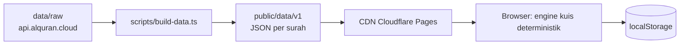

# Sambung Ayat

Kuis hafalan Al-Qur'an gratis, tanpa login dan tanpa backend: enam mode: Sambung Ayat, Ayat Sebelumnya, Lengkapi Ayat, Tebak Surah, Tebak Juz, dan Tebak Ayat dari Audio. Situs: <https://sambungayat.com>

<!-- TODO: tambahkan 3-4 screenshot (beranda, soal, hasil, mode guru) di docs/screenshots -->

## Fitur

- 6 mode kuis, cakupan per juz / surah / rentang surah / rentang ayat, 2 tingkat kesulitan, 12 bahasa antarmuka (termasuk Arab dan Urdu).
- Tantangan Harian: 10 soal yang sama untuk semua orang (hari Jakarta), skor resmi = percobaan pertama.
- Mode Guru: tautan + QR yang menghasilkan soal identik di semua perangkat.
- Riwayat dan penguasaan per surah, disimpan di perangkat (localStorage).
- 114 halaman surah statis untuk SEO, PWA offline (Juz 30), APK Android (Capacitor).

## Arsitektur



Tidak ada backend: teks Al-Qur'an tidak berubah, jadi semuanya JSON statis di CDN dan seluruh logika kuis berjalan di browser. Hasilnya murah, cepat, bisa offline, dan tidak ada data pengguna yang meninggalkan perangkat.

## Keputusan utama

- **Kuis deterministik berbasis seed.** Kunci RNG = `mode|cakupan|kesulitan|seed`; jumlah soal tidak ikut, jadi kuis 5 soal adalah awalan kuis 10 soal. Ini yang membuat tautan harian dan tautan guru identik di semua perangkat. Mengubah generator, urutan tier, `neededSurahs`, format kunci, atau `dailySeed` memutus tautan lama (lihat `CLAUDE.md`).
- **Ayat berulang.** Soal Sambung dibuang jika teks ayat diikuti ayat berbeda di tempat lain; Tebak Surah/Audio membuang 276 ayat ambigu (`ambiguous.json`).
- **Basmalah** dipisahkan dari ayat 1 dengan mencocokkan 4 kata pertama yang dinormalisasi.
- **Normalisasi hanya untuk perbandingan.** Teks yang ditampilkan tidak pernah diubah.
- **Jalur data berversi** (`/data/v1/`, immutable 1 tahun). Perubahan keluaran data wajib naik ke `v2` (daftar tempat di `CLAUDE.md`).
- CSP ketat; hash skrip inline diisi otomatis oleh `scripts/postbuild.ts`, yang juga menjaga budget JS `/kuis` (120 KB gzip).

## Menjalankan di lokal

Butuh Node 26.13.0 (`.nvmrc`; dengan nvm cukup `nvm use`).

```bash
npm ci
npm run data:fetch -- --missing-only   # unduh terjemahan Al-Qur'an (tidak disimpan di repo)
npm run data:build                     # bangun data ke public/data/v1
npm run dev                            # http://localhost:4321
```

Data hasil build ada di `public/data/v1` (tidak di-commit). Kalau halaman kuis kosong, biasanya dua langkah data di atas belum dijalankan.

Build produksi dan pratinjau lokal:

```bash
npm run build      # data:build + astro build + postbuild (CSP, budget JS)
npm run preview    # http://localhost:4321
```

| Perintah                     | Fungsi                                      |
| ---------------------------- | ------------------------------------------- |
| `npm run lint` / `typecheck` | ESLint / `astro check`                      |
| `npm test`                   | data:build, data:verify, Vitest             |
| `npm run test:e2e`           | Playwright (Chromium, Pixel 5 + desktop)    |
| `npm run data:fetch`         | Unduh ulang semua data mentah ke `data/raw` |
| `npm run data:verify-audio`  | Cek URL audio tiap qari                     |
| `npm run android:apk`        | APK debug (butuh JDK 21 dan Android SDK)    |

Untuk Playwright, pasang browser sekali: `npx playwright install chromium`. Panduan lengkap untuk developer: [docs/developer-guide.md](docs/developer-guide.md).

## Pengujian dan CI

Unit test (Vitest) memakai data hasil build sungguhan, termasuk uji properti 300 seed per cakupan dan mode. E2E (Playwright) mencakup alur beranda ke hasil, tautan guru dan harian di dua konteks, offline, dan halaman surah. GitHub Actions (`.github/workflows/ci.yml`) menjalankan semuanya pada tiap push dan PR.

## Statistik

Tidak ada akun dan tidak ada pelacakan di dalam kuis. Situs menghitung secara anonim berapa kuis yang selesai (hanya mode dan tanggal) untuk angka di beranda. Rinciannya ada di [kebijakan privasi](https://sambungayat.com/privasi).

## Roadmap

Arti nama surah, qari tambahan, tinjauan terjemahan oleh penutur asli, mode kelas dengan papan skor lokal. Ide dan tugas awal: [docs/good-first-issues.md](docs/good-first-issues.md).

## Atribusi dan lisensi

- Kode: MIT, lihat [LICENSE](LICENSE). Kredit dan syarat data (teks, terjemahan, audio, font): [NOTICE.md](NOTICE.md). Nama dan logo: [BRAND.md](BRAND.md). Berkontribusi: [CONTRIBUTING.md](CONTRIBUTING.md).
- Teks Al-Qur'an: [Tanzil Project](https://tanzil.net) (edisi Uthmani), lewat [AlQuran.cloud](https://alquran.cloud) API. Syarat Tanzil: teks tidak boleh diubah dan atribusi serta tautan ke tanzil.net harus menyertai redistribusi. Data turunan hanya memisahkan Basmalah dan menghapus BOM. Teks lengkap pemberitahuan hak cipta Tanzil ada di [NOTICE.md](NOTICE.md).
- Terjemahan: edisi AlQuran.cloud/Tanzil, diunduh saat build dan tidak disimpan di repo ini; daftar edisi dan syaratnya di [NOTICE.md](NOTICE.md).
- Audio: [EveryAyah](https://everyayah.com), dimuat dari sumbernya; di aplikasi Android pengguna boleh menyimpannya untuk dipakai offline.
- Bukan pengganti talaqqi dengan guru.
