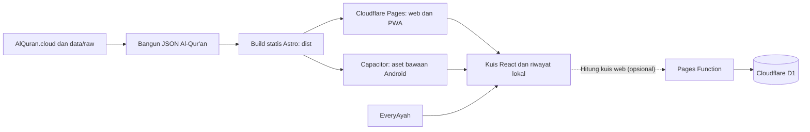

# Panduan teknis Sambung Ayat

**Bahasa Indonesia** · [English](developer-guide.md)

Untuk pengelola aplikasi web, PWA, dan Android. Mulai dari [aturan kontribusi](../CONTRIBUTING.md) dan [atribusi data](../NOTICE.md). Untuk terjemahan antarmuka, baca [panduan peninjauan terjemahan](translation-review-guide.md); untuk tampilan dan identitas visual, baca [DESIGN.md](../DESIGN.md) dan [BRAND.md](../BRAND.md).

## 1. Pengembangan lokal

Pasang versi Node dari [.nvmrc](../.nvmrc) (saat ini 26.13.0). Jalankan dari direktori utama repositori:

```sh
nvm install && nvm use
npm ci
npm run data:fetch -- --missing-only
npm run data:build
npm run dev
```

Buka <http://localhost:4321>. Langkah pengunduhan melengkapi berkas sumber Al-Qur'an yang belum ada, termasuk terjemahan yang tidak disimpan di Git. Server dev tidak membuat data itu sendiri. Jika berkas sumber sudah ada, `npm run build` membangun ulang data dan menghasilkan `dist/`; gunakan `npm run preview` untuk membukanya. Astro dev/preview tidak menjalankan API Cloudflare atau menerapkan `_headers` milik Pages.

## 2. Arsitektur dan rute

Astro 5 menghasilkan HTML statis; komponen interaktif diaktifkan sebagai React island. TypeScript memakai mode strict dan Tailwind 4 mengatur tampilan. Kuis tidak memerlukan akun maupun server. API Cloudflare hanya menyediakan penghitung penyelesaian kuis yang opsional.



| Lokasi                                                                                           | Tanggung jawab                                                                                       |
| ------------------------------------------------------------------------------------------------ | ---------------------------------------------------------------------------------------------------- |
| [`src/pages/`](../src/pages) → [`src/views/`](../src/views)                                      | Rute meneruskan ke templat halaman dengan prop `lang`.                                               |
| [`BaseLayout.astro`](../src/layouts/BaseLayout.astro)                                            | Bahasa, SEO, pengaturan sebelum halaman tampil, pendaftaran service worker, dan inisialisasi native. |
| [`components/quiz/`](../src/components/quiz), [`components/teacher/`](../src/components/teacher) | Pengaturan, permainan, dan hasil kuis, serta komponen tautan guru dan rekap.                         |
| [`lib/quiz/`](../src/lib/quiz), [`lib/quran/`](../src/lib/quran)                                 | Pembuatan kuis berbasis seed, konfigurasi URL, cakupan, pemuatan data, dan perbandingan teks.        |
| [`lib/storage/`](../src/lib/storage), [`lib/native/`](../src/lib/native)                         | Progres/pengaturan lokal dan integrasi Capacitor yang dimuat saat dibutuhkan.                        |
| [`scripts/`](../scripts), [`data/`](../data), [`locales/`](../locales)                           | Peralatan build, sumber dan konfigurasi edisi Al-Qur'an, serta katalog antarmuka.                    |
| [`functions/`](../functions), [`migrations/`](../migrations), [`android/`](../android)           | API opsional dan skema D1; proyek Android native.                                                    |

Rute bahasa Indonesia tidak memakai awalan. Bahasa lain memakai `/<code>/`, misalnya `/en/kuis`. Astro menghasilkan berkas seperti `kuis.html` dan `en/kuis.html`, tetapi tautan publik tidak mencantumkan ekstensi atau garis miring di akhir. Jangan terjemahkan segmen rute atau ubah slug surah.

| Rute                        | Fungsi                                                                           |
| --------------------------- | -------------------------------------------------------------------------------- |
| `/kuis`                     | Pengaturan kuis atau langsung mulai jika parameter URL valid.                    |
| `/harian`                   | Tantangan harian mengikuti tanggal Jakarta.                                      |
| `/guru`, `/rekap`           | Buat tautan kuis dan kode QR; tempel tag hasil siswa untuk membuat rekap lokal.  |
| `/riwayat`                  | Riwayat dan penguasaan di perangkat yang sedang dipakai.                         |
| `/surah/<slug>`, `/juz/<n>` | Halaman bacaan statis dengan tautan ke kuis.                                     |
| `/offline`, `/kontribusi`   | Halaman cadangan offline; halaman kontribusi khusus bahasa Inggris tanpa awalan. |

## 3. Data Al-Qur'an dan audio

[`fetch-quran.ts`](../scripts/fetch-quran.ts) mengunduh edisi dari AlQuran.cloud. Teks Arab bersumber dari Tanzil Uthmani. [`build-data.ts`](../scripts/build-data.ts) menghasilkan direktori `public/data/v1/`, yang diabaikan Git dan disalin ke hasil build.

| Keluaran                          | Isi                                                                                                                                             |
| --------------------------------- | ----------------------------------------------------------------------------------------------------------------------------------------------- |
| `index.json`, `juz.json`          | Metadata surah (termasuk slug yang tetap) dan batas juz.                                                                                        |
| `surah/NNN.json`                  | Nomor ayat dalam surah dan global, juz/halaman, teks Arab untuk tampilan, hasil normalisasi, token kata, dan terjemahan Indonesia.              |
| `tr/<lang>/NNN.json`              | Terjemahan bahasa lain sesuai urutan ayat: ayat 1 ada pada indeks 0. Daftar edisi ada di [`data/translations.json`](../data/translations.json). |
| `ambiguous.json`, `manifest.json` | ID global ayat dengan teks normalisasi berulang; versi build, waktu build, dan hash berkas.                                                     |

Proses build membuang BOM dan mencocokkan empat kata pertama yang dinormalisasi untuk memisahkan Basmalah pembuka. Di Al-Fatihah, Basmalah tetap menjadi ayat 1; At-Taubah tidak memiliki Basmalah pembuka; Basmalah di tengah An-Naml tetap dipertahankan. Pakai `ar` atau token kata untuk tampilan; `arNorm` hanya untuk perbandingan. Jangan menyunting teks Al-Qur'an, data mentah, atau hasil build secara manual. [`verify-data.ts`](../scripts/verify-data.ts) memeriksa penomoran, jumlah dan batas juz, konsistensi teks serta token, dan aturan Basmalah.

[Modul pemuat data](../src/lib/quran/loader.ts) mengambil metadata serta surah yang dibutuhkan cakupan kuis. Permintaan yang masih berjalan dipakai bersama, sedangkan permintaan gagal dibuang dari cache agar dapat dicoba ulang. Terjemahan kuis selain Indonesia dimuat terpisah; jawaban dapat memakai terjemahan Indonesia jika tidak tersedia. [`reciters.ts`](../src/config/reciters.ts) memetakan ID qari ke URL EveryAyah (`SSSAAA.mp3`, masing-masing tiga digit untuk surah dan ayat). Pertahankan ID yang ada dan jalankan `npm run data:verify-audio` saat mengubah daftar qari.

**Versi data:** Pages menyimpan `/data/v1/*` sebagai konten immutable selama satu tahun. Naikkan versi jalur sebelum menerbitkan perubahan data pada URL lama. Cari `data/v1` di skrip build/verifikasi, pemuat data (termasuk terjemahan), halaman/layout statis, skrip pemuatan awal, aturan PWA, dan [`_headers`](../public/_headers); ubah semuanya bersama. Baca [catatan lisensi data](data-licenses.md) sebelum menambah edisi atau mendistribusikan ulang data.

## 4. Kontrak kuis dan tautan berbagi

Contoh: [`/kuis?mode=sambung&scope=juz:30&n=10&d=mudah&seed=contoh`](https://sambungayat.com/kuis?mode=sambung&scope=juz:30&n=10&d=mudah&seed=contoh). [`url.ts`](../src/lib/quiz/url.ts) memvalidasi:

| Parameter | Nilai yang diterima                                                                                                                                       |
| --------- | --------------------------------------------------------------------------------------------------------------------------------------------------------- |
| `mode`    | `sambung`, `sebelum`, `lengkapi`, `tebak-surah`, `tebak-juz`, `tebak-audio`.                                                                              |
| `scope`   | `juz:29,30`, `surah:112,113`, `range:78-114` (rentang surah inklusif), atau `ayat:2:1-7` (rentang ayat inklusif dalam satu surah).                        |
| `n`, `d`  | 5, 10, atau 20 soal; `mudah` atau `sulit`.                                                                                                                |
| `seed`    | 1–40 karakter berupa huruf kecil ASCII, angka, atau tanda hubung. Saat halaman pertama dimuat, seed kosong/tidak valid diganti jika parameter lain valid. |

[`generateQuiz(config, data)`](../src/lib/quiz/engine.ts) mengacak calon soal dan membuat soal secara deterministik berdasarkan seed. Kunci RNG adalah `mode|scope|difficulty|seed`. Jumlah soal tidak ikut: kuis yang lebih pendek menjadi awalan kuis yang lebih panjang jika kunci dan data sama. Gunakan `getView`, bukan `data.surahs` langsung: `neededSurahs` menambahkan tetangga langsung setiap surah dalam cakupan agar hasilnya sama dengan data lengkap maupun sebagian. Cakupan juz dan rentang ayat menyaring soal per ayat. Pada `sambung` dan `sebelum`, jawaban dapat tepat di luar rentang ayat yang dipilih, tetapi tetap dalam surah yang sama.

| Mode                          | Jawaban benar dan syarat soal                                                                                                    |
| ----------------------------- | -------------------------------------------------------------------------------------------------------------------------------- |
| `sambung` / `sebelum`         | Ayat berikutnya/sebelumnya; soal ditolak jika teksnya punya kelanjutan/pendahulu yang berbeda dalam data yang dipakai generator. |
| `lengkapi`                    | Bagian akhir ayat yang disembunyikan; ayat terlalu pendek atau soal dengan lebih dari satu kelanjutan ditolak.                   |
| `tebak-surah` / `tebak-audio` | Tebak surah dari teks atau tebak ayat dari audio; keduanya mengecualikan ayat berulang dari `ambiguous.json`.                    |
| `tebak-juz`                   | Tebak juz; mode sulit mengutamakan juz terdekat sebagai pengecoh.                                                                |

[`QuizApp`](../src/components/quiz/QuizApp.tsx) beralih dari inisialisasi ke pengaturan atau pemuatan, lalu ke permainan/hasil. Pemuatan gagal dapat dicoba ulang. Mesin menetapkan `reduced` jika jumlah soal yang diminta tidak terpenuhi, termasuk jika tidak ada soal. Soal yang audionya gagal bisa dilewati dan tidak masuk skor, jumlah soal di riwayat, atau penguasaan. Latihan soal yang salah hanya berlangsung di memori, tanpa mengubah progres atau penghitung publik.

- **Harian:** `sambung`, Juz 30, 10 soal, `mudah`. Seed berbentuk `YYYY-MM-DD-harian-v1` berdasarkan `Asia/Jakarta`. Percobaan pertama yang selesai pada perangkat itu menjadi skor resmi untuk tanggal tersebut; percobaan berikutnya menambah jumlah percobaan.
- **Guru:** kode QR berisi URL `/kuis` dengan seed, bukan kelas di server. Siswa bisa memilih untuk membagikan tag seperti `SA«Nama»8/10#contoh`. Kodenya adalah 12 karakter pertama seed. [`parseRecap`](../src/lib/recap.ts) mengambil persentase terbaik untuk setiap pasangan nama dan kode dari teks yang ditempel, tanpa membedakan huruf besar-kecil pada nama. Rekap ini bukan buku nilai dengan verifikasi identitas.
- **Kompatibilitas:** logika generator, urutan pilihan calon soal dan tingkat prioritas pengecoh, kunci cakupan, ID mode, `neededSurahs`, kunci RNG, dan `dailySeed` menentukan hasil tautan yang sudah beredar. Bahas perubahan versi lebih dahulu. Selaraskan skrip pemuatan awal halaman kuis/harian dengan `neededSurahs`. Pengujian [cakupan](../tests/unit/scope-pins.test.ts), [URL/RNG](../tests/unit/rng-url.test.ts), dan [harian](../tests/unit/daily.test.ts) menjaga sebagian kontrak ini.

## 5. Penyimpanan, bahasa, dan penggunaan offline

**Data lokal.** Di bawah awalan `sa:v1:`, `settings` menyimpan pengaturan tampilan/audio; `history` menyimpan 100 hasil terakhir; `mastery` mencatat percobaan dan jawaban benar per mode dan surah; `daily` menyimpan skor pertama dan jumlah percobaan per tanggal Jakarta. Jika penyimpanan lokal gagal, data hanya disimpan di memori. Tidak ada sinkronisasi antarperangkat. Jaga agar inisialisasi tema serta ukuran teks Arab di layout tetap sama dengan `applySettings`.

**Bahasa.** [`locales/<lang>/<namespace>.json`](../locales) berisi katalog dengan kunci datar. `getDict(lang, namespaces)` merakit namespace yang diminta dengan bahasa Indonesia sebagai cadangan. `t` mengisi `{name}`; `tp` memilih bentuk jamak. Bungkus island dengan `I18nProvider` dan impor fungsi klien dari [`i18n/core.ts`](../src/lib/i18n/core.ts), bukan pemuat semua katalog. Untuk bahasa baru, tambahkan ke `LANGS` di berkas itu, buat semua katalog, dan atur edisi terjemahan Al-Qur'an. Uji tata letak dan rute bahasa. Arab dan Urdu memakai arah kanan-ke-kiri: gunakan properti jarak dan perataan logis. Jangan terjemahkan kunci URL, ID, seed, jalur data, atau tag rekap.

**Web offline.** [`astro.config.mjs`](../astro.config.mjs) mengatur Workbox. Cache awal memuat halaman kuis Indonesia, aset bersama, dan data surah 077–114 (077 adalah tetangga yang dibutuhkan Juz 30). Navigasi di luar cache awal mencoba jaringan terlebih dahulu, lalu cache atau halaman offline sesuai bahasa jika tersedia. Surah/terjemahan lain dapat tersimpan setelah dipakai. Sesudah kunjungan online, layout juga mencoba menyimpan beranda, halaman kuis, halaman offline, dan terjemahan Juz 30 untuk bahasa selain Indonesia yang sedang dipakai, kecuali saat Hemat Data aktif. Kunjungan pertama tanpa internet dan cakupan sembarang yang belum tersimpan tidak didukung.

**Audio offline.** Audio tidak masuk cache awal. Unduhan manual di web masuk Cache API `sa-audio` dan dilayani service worker dengan dukungan Range. Unduhan Android masuk penyimpanan aplikasi; pemutar mencari berkas tersimpan sebelum memakai EveryAyah. Unduh audio qari dan cakupan pilihan sebelum menguji pemutaran offline.

## 6. Penerbitan web dan API

- **Build statis:** di Cloudflare Pages, gunakan versi Node dari `.nvmrc`, perintah build `npm run data:fetch -- --missing-only && npm run build`, dan direktori keluaran `dist`. Build dari direktori utama repositori jika menyertakan Pages Functions; [`public/_routes.json`](../public/_routes.json) membatasi pemanggilan ke `/api/*`.
- **Header:** [`postbuild.ts`](../scripts/postbuild.ts) mengisi hash CSP skrip inline ke `dist/_headers`, memeriksa batas 2.000 karakter per baris di Pages, dan membatasi JavaScript halaman kuis tiap bahasa hingga 120 KB gzip. Build ulang, jangan mengedit hasil build.
- **Analitik opsional:** biarkan variabel analitik kosong agar analitik nonaktif. [`.env.example`](../.env.example) mencantumkan `PUBLIC_CF_BEACON_TOKEN`. Layout juga mendukung `PUBLIC_PLAUSIBLE_DOMAIN` dan `PUBLIC_PLAUSIBLE_SRC` yang opsional. Setel variabel Plausible di lingkungan proses build agar terbaca oleh Astro dan tahap pengisian CSP.
- **Penghitung D1 opsional:** buat basis data, terapkan [`0001_stats.sql`](../migrations/0001_stats.sql) melalui [migrasi D1](https://developers.cloudflare.com/d1/reference/migrations/), ganti ID contoh di [`wrangler.toml`](../wrangler.toml) untuk penerbitan Anda, lalu pasang binding `DB`. Tetapkan `STATS_SALT` sebagai secret di server untuk POST, bukan variabel build publik. Untuk domain lain, periksa daftar origin yang diizinkan di [`stats/server.ts`](../src/lib/stats/server.ts) dan URL kanonis. Untuk hosting statis, jangan sertakan fungsi ini alih-alih menjalankan handler GET tanpa basis data.

| Permintaan        | Kontrak                                                                                                                                                                                                                                                 |
| ----------------- | ------------------------------------------------------------------------------------------------------------------------------------------------------------------------------------------------------------------------------------------------------- |
| `GET /api/stats`  | Mengembalikan `{ total, week }`: total sepanjang waktu serta hari UTC berjalan dan enam hari sebelumnya. Cache 60 detik. Beranda menyembunyikan penghitung jika gagal atau total di bawah 20, dan menyembunyikan angka pekan berjalan jika di bawah 10. |
| `POST /api/stats` | Isi `{"mode":"sambung"}` (ID mode yang valid); mengembalikan `{"ok":true}`. Penolakan: 400 (JSON/mode), 403 (origin), 429 (batas harian), atau 503 (salt belum diatur pada origin yang diizinkan). Metode lain menghasilkan 405.                        |

Klien menghitung kuis yang selesai, termasuk tantangan harian tetapi bukan latihan ulang, hanya di web. D1 mengagregasi berdasarkan tanggal UTC dan mode, bukan tanggal Jakarta. Penghitung tidak menyimpan skor, nama, IP mentah, atau riwayat kuis. Hash IP harian dengan salt membatasi pengiriman sampai 300 per hari; baris hash lama dihapus saat pengiriman pertama dari suatu klien pada hari baru diproses. Kegagalan API tidak menghalangi penyelesaian kuis.

## 7. Android

Pasang JDK 21 dan Android SDK (compile/target API 36, minimum API 24; lihat [`android/variables.gradle`](../android/variables.gradle)). Atur `ANDROID_HOME` dan unduh data Al-Qur'an sebelum build.

| Perintah               | Keluaran                                                                                       |
| ---------------------- | ---------------------------------------------------------------------------------------------- |
| `npm run android:sync` | Membuat `dist` dan menyinkronkannya ke proyek native.                                          |
| `npm run android:apk`  | APK debug di `android/app/build/outputs/apk/debug/app-debug.apk`.                              |
| `npm run android:aab`  | AAB dan APK rilis di `android/app/build/outputs/`; siapkan penandatanganan sebelum distribusi. |

Pengelola menyediakan keystore dan `android/keystore.properties` yang diabaikan Git (`storeFile`, `storePassword`, `keyAlias`, `keyPassword`). Jangan commit berkas ini. Perbarui `versionCode` dan `versionName` di [`app/build.gradle`](../android/app/build.gradle) sesuai rilis.

Capacitor memuat `dist` yang dibundel melalui `https://localhost` tanpa service worker. Navigasi internal mengarah ke berkas `.html` dalam paket; tautan berbagi memakai `SITE.url` publik, bukan origin WebView. [`native/links.ts`](../src/lib/native/links.ts) memetakan tautan publik yang didukung ke halaman di paket sambil mempertahankan parameter kuis. Verifikasi App Links memerlukan `/.well-known/assetlinks.json` di server dengan sidik jari sertifikat penandatangan aplikasi; filter di manifest saja tidak cukup. Tampilan Tailwind 4 memerlukan Chromium 111+; WebView yang lebih lama menampilkan pemberitahuan untuk memperbarui.

## 8. Pengujian, pemeliharaan, dan pemecahan masalah

| Pemeriksaan                                                | Cakupan                                                                                                                              |
| ---------------------------------------------------------- | ------------------------------------------------------------------------------------------------------------------------------------ |
| `npm run lint`, `npm run typecheck`                        | ESLint dan diagnostik Astro/TypeScript.                                                                                              |
| `npm test`                                                 | Build dan verifikasi data Al-Qur'an, lalu Vitest (generator, tautan, bahasa, rekap, penyimpanan, statistik).                         |
| `npm run build`                                            | Rute statis, service worker, CSP, dan batas ukuran JavaScript kuis.                                                                  |
| `npx playwright install chromium`, lalu `npm run test:e2e` | Chromium desktop dan emulasi Pixel 5: kuis/tautan berbagi, bahasa, offline, penyesuaian UI native, dan penghitung dengan API tiruan. |

[GitHub Actions](../.github/workflows/ci.yml) berjalan pada PR dan push ke `main`. CI menyimpan cache terjemahan, mengunduh data yang belum ada, memvalidasi aplikasi, dan mengunggah hasil Playwright jika gagal. Playwright dapat memakai ulang server di port 4321; hentikan server dev/preview lama saat memvalidasi build baru.

| Gejala                                             | Pemeriksaan pertama                                                                                                      |
| -------------------------------------------------- | ------------------------------------------------------------------------------------------------------------------------ |
| Data hilang atau kuis kosong                       | Unduh data mentah yang belum ada, build data, dan periksa permintaan `/data/v1/`.                                        |
| Tautan dengan seed berbeda hasilnya antarperangkat | Bandingkan parameter lengkap, versi aplikasi/data, dan perilaku generator/cakupan.                                       |
| Kuis/terjemahan tidak tersedia offline             | Pastikan halaman dikontrol service worker setelah kunjungan online dan periksa cakupan serta bahasa yang tersimpan.      |
| Penghitung tidak tampil                            | Wajar di dev/preview, Android, atau saat total masih rendah. Di Pages periksa binding, migrasi, origin POST, dan secret. |
| Halaman Android lama atau tanpa gaya               | Build dan sinkronkan ulang aset; periksa versi WebView yang dipasang.                                                    |

Saat menambah halaman, selaraskan rute Indonesia dan rute bahasa lain, tambahkan navigasi bila perlu, serta tambahkan kunci teks di semua bahasa. Untuk mode kuis baru, daftarkan generator, ID URL/konfigurasi, dan label di katalog bahasa; uji agar hasil seed lama tidak berubah. Jaga `src/` dan `scripts/` tetap ASCII serta kode/komentar dalam bahasa Inggris. Pakai [token desain bersama](../src/styles/global.css); untuk perubahan tampilan, sertakan tangkapan layar tema terang dan gelap pada lebar 360 px. Perbarui kedua edisi bahasa saat mengubah kontrak yang didokumentasikan.
