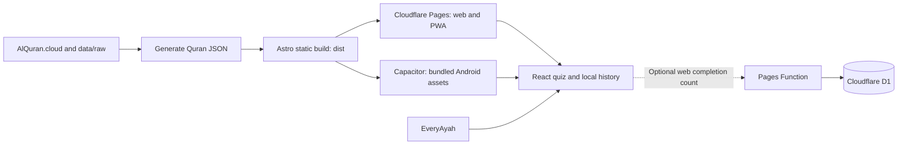

# Sambung Ayat technical guide

[Bahasa Indonesia](developer-guide.id.md) · **English**

For web, PWA, Android, and iOS maintainers. Start with the [contribution rules](../CONTRIBUTING.md) and [data attribution](../NOTICE.md). For interface translations, see the [translation review guide](translation-review-guide.md); for UI and visual identity, see [DESIGN.md](../DESIGN.md) and [BRAND.md](../BRAND.md).

## 1. Local development

Install the Node version in [.nvmrc](../.nvmrc) (currently 26.13.0). From the repository root:

```sh
nvm install && nvm use
npm ci
npm run data:fetch -- --missing-only
npm run data:build
npm run dev
```

Open <http://localhost:4321>. Fetching fills in missing Quran source files, including translations not checked into Git. The dev server does not generate the data. Once inputs are present, `npm run build` regenerates the data and produces `dist/`; use `npm run preview` to serve it. Astro dev/preview do not run the Cloudflare API or apply Pages' `_headers`.

## 2. Architecture and routes

Astro 5 emits static HTML; interactive components hydrate as React islands. TypeScript is strict, and Tailwind 4 supplies the styling. The quiz needs neither accounts nor a server. Cloudflare's API only provides the optional public completion counter.



| Path                                                                                             | Responsibility                                                                             |
| ------------------------------------------------------------------------------------------------ | ------------------------------------------------------------------------------------------ |
| [`src/pages/`](../src/pages) → [`src/views/`](../src/views)                                      | Thin routes delegate to views with a `lang` prop.                                          |
| [`BaseLayout.astro`](../src/layouts/BaseLayout.astro)                                            | Locale, SEO, settings before first paint, service worker registration, and native startup. |
| [`components/quiz/`](../src/components/quiz), [`components/teacher/`](../src/components/teacher) | Quiz setup, play, results, and teacher link/recap islands.                                 |
| [`lib/quiz/`](../src/lib/quiz), [`lib/quran/`](../src/lib/quran)                                 | Seeded generation, URL configuration, scope, loading, and text comparison.                 |
| [`lib/storage/`](../src/lib/storage), [`lib/native/`](../src/lib/native)                         | Local progress/settings and lazily loaded Capacitor integrations.                          |
| [`scripts/`](../scripts), [`data/`](../data), [`locales/`](../locales)                           | Build tools, Quran source/edition configuration, and UI catalogs.                          |
| [`functions/`](../functions), [`migrations/`](../migrations), [`android/`](../android)           | Optional API and D1 schema; native Android project.                                        |

Indonesian routes have no prefix. Other languages use `/<code>/`, for example `/en/kuis`. Astro writes files such as `kuis.html` and `en/kuis.html`, while public links are extensionless with no trailing slash. Do not translate path segments or change surah slugs.

| Route                       | Behavior                                                                       |
| --------------------------- | ------------------------------------------------------------------------------ |
| `/kuis`                     | Quiz setup or direct play from a valid query.                                  |
| `/harian`                   | Daily challenge based on the Jakarta calendar.                                 |
| `/guru`, `/rekap`           | Generate a quiz link and QR code; paste student result tags for a local recap. |
| `/riwayat`                  | History and mastery on the current device.                                     |
| `/surah/<slug>`, `/juz/<n>` | Static reading pages with links into quizzes.                                  |
| `/offline`, `/kontribusi`   | Offline fallback; English-only contribution page at the root.                  |

## 3. Quran data and audio

[`fetch-quran.ts`](../scripts/fetch-quran.ts) downloads editions from AlQuran.cloud. The Arabic source is Tanzil Uthmani. [`build-data.ts`](../scripts/build-data.ts) generates the git-ignored `public/data/v1/` directory, which is copied into the build.

| Output                            | Contents                                                                                                                                 |
| --------------------------------- | ---------------------------------------------------------------------------------------------------------------------------------------- |
| `index.json`, `juz.json`          | Surah metadata (including stable slugs) and juz boundaries.                                                                              |
| `surah/NNN.json`                  | Local and global ayah numbers, juz/page, display Arabic, comparison form, tokens, and Indonesian translation.                            |
| `tr/<lang>/NNN.json`              | Other translations in ayah order: ayah 1 is array index 0. Editions are listed in [`data/translations.json`](../data/translations.json). |
| `ambiguous.json`, `manifest.json` | Global ayah IDs for repeated normalized text; build version, timestamp and file hashes.                                                  |

The builder removes the BOM and matches the first four normalized words to separate the leading Basmalah. Al-Fatihah retains it as ayah 1, At-Taubah has no Basmalah header, and the Basmalah within An-Naml is retained. Use `ar` or tokens for rendering; `arNorm` is only for comparison. Never hand-edit Quran text, raw inputs, or generated files. [`verify-data.ts`](../scripts/verify-data.ts) checks numbering, counts, juz boundaries, text/token invariants, and Basmalah rules.

The [loader](../src/lib/quran/loader.ts) fetches metadata plus only the surahs needed by the scope. It reuses pending requests and evicts failures so they can be retried. Non-Indonesian quiz translations are loaded separately; the answer can fall back to Indonesian. [`reciters.ts`](../src/config/reciters.ts) maps reciter IDs to EveryAyah URLs (`SSSAAA.mp3`, three digits each for surah and ayah). Keep those IDs stable and run `npm run data:verify-audio` when changing the catalog.

**Versioning:** Pages caches `/data/v1/*` as immutable for one year. Bump the data path before shipping changed data at existing URLs. Search for `data/v1` in the build/verify scripts, loaders (including translations), static views/layout, early-fetch scripts, PWA rules, and [`_headers`](../public/_headers); move them together. Review the [data licensing notes](data-licenses.md) before adding editions or redistributing data.

## 4. Quiz and sharing contracts

Example: [`/kuis?mode=sambung&scope=juz:30&n=10&d=mudah&seed=contoh`](https://sambungayat.com/kuis?mode=sambung&scope=juz:30&n=10&d=mudah&seed=contoh). [`url.ts`](../src/lib/quiz/url.ts) validates:

| Parameter | Accepted values                                                                                                                     |
| --------- | ----------------------------------------------------------------------------------------------------------------------------------- |
| `mode`    | `sambung`, `sebelum`, `lengkapi`, `tebak-surah`, `tebak-juz`, `tebak-audio`.                                                        |
| `scope`   | `juz:29,30`, `surah:112,113`, `range:78-114` (inclusive surahs), or `ayat:2:1-7` (inclusive ayahs of one surah).                    |
| `n`, `d`  | 5, 10 or 20 questions; `mudah` or `sulit`.                                                                                          |
| `seed`    | 1–40 lowercase ASCII letters, digits, or hyphens. On initial load a missing/invalid seed is replaced if all other fields are valid. |

[`generateQuiz(config, data)`](../src/lib/quiz/engine.ts) shuffles eligible prompts and builds questions with seeded randomness. The RNG key is `mode|scope|difficulty|seed`. Count is excluded: a smaller quiz is a prefix of a larger one given the same key and data. Use `getView`, not `data.surahs` directly: `neededSurahs` adds immediate neighbors to in-scope surahs so generation is identical with full or partial data. Juz and ayah-range scopes filter prompts by ayah. In `sambung` and `sebelum`, the answer can be just outside the selected ayah range but stays in the same surah.

| Mode                          | Correct answer and eligibility                                                                       |
| ----------------------------- | ---------------------------------------------------------------------------------------------------- |
| `sambung` / `sebelum`         | Next/previous ayah; reject prompts with conflicting successors/predecessors in the generator view.   |
| `lengkapi`                    | Hidden ending of an ayah; reject too-short prompts and ambiguous completions.                        |
| `tebak-surah` / `tebak-audio` | Identify a surah from text or an ayah from audio; both exclude repeated ayahs from `ambiguous.json`. |
| `tebak-juz`                   | Identify the juz; hard mode prefers nearby juz as distractors.                                       |

[`QuizApp`](../src/components/quiz/QuizApp.tsx) moves from boot to setup or loading, then play/results; failed loads can be retried. The engine sets `reduced` if it cannot produce the requested count, including an empty pool. Audio failures can be skipped; skipped questions do not contribute to scores, history totals, or mastery. Practice with wrong answers runs in memory and does not update progress or the public counter.

- **Daily:** `sambung`, Juz 30, 10 questions, `mudah`. The seed is `YYYY-MM-DD-harian-v1` in `Asia/Jakarta`. The first finish on that device supplies the official score for the date; later finishes increment the attempt count.
- **Teacher:** the QR encodes a seeded `/kuis` URL, not a server-side class. A student can choose to share a tag such as `SA«Name»8/10#example`. The code is the first 12 characters of the seed. [`parseRecap`](../src/lib/recap.ts) keeps the best percentage per case-insensitive name and code from pasted text. This is not an authenticated gradebook.
- **Compatibility:** generator logic, candidate and tier order, scope keys, mode IDs, `neededSurahs`, the RNG key, and `dailySeed` define existing links. Discuss a versioned change first. Keep the quiz/daily early-fetch scripts aligned with `neededSurahs`. [Scope](../tests/unit/scope-pins.test.ts), [URL/RNG](../tests/unit/rng-url.test.ts), and [daily](../tests/unit/daily.test.ts) tests pin parts of the contract.

## 5. State, localization, and offline

**Local data.** Under `sa:v1:`, `settings` stores display/audio preferences; `history` keeps the latest 100 results; `mastery` tracks attempts and correct answers per mode and surah; `daily` stores the first score and attempt count per Jakarta date. Storage failures fall back to memory. There is no cross-device sync. Keep the inline theme and Arabic size initialization in step with `applySettings`.

**Localization.** [`locales/<lang>/<namespace>.json`](../locales) holds flat catalogs. `getDict(lang, namespaces)` assembles the requested namespaces with Indonesian fallback. `t` interpolates `{name}`; `tp` selects plurals. Wrap islands in `I18nProvider` and import client helpers from [`i18n/core.ts`](../src/lib/i18n/core.ts), not the all-catalog loader. To add a language, extend `LANGS` there, add all catalogs, and configure a Quran translation edition. Test layout and locale routes. Arabic and Urdu are RTL: use logical spacing and alignment. Never translate URL keys, IDs, seeds, data paths, or recap tags.

**Web offline.** [`astro.config.mjs`](../astro.config.mjs) configures Workbox. The precache includes the Indonesian quiz shell, shared assets, and Quran data for surahs 077–114 (077 is Juz 30's required neighbor). Navigations outside the precache use a network-first cache and, when available, a localized offline fallback. Other surahs/translations can be cached after use. After an online visit, the layout also tries to cache the current non-Indonesian locale's home, quiz, offline page and Juz 30 translations, unless Data Saver is on. A first-ever offline visit and arbitrary uncached scopes are not supported.

**Offline audio.** Audio is not precached. Explicit web downloads use the `sa-audio` Cache API store, served by the service worker with Range support. Android downloads use app storage; the player resolves a saved file before falling back to EveryAyah. Download audio for the chosen reciter and scope before testing offline playback.

## 6. Web deployment and API

- **Static build:** in Cloudflare Pages use the Node version from `.nvmrc`, build with `npm run data:fetch -- --missing-only && npm run build`, and publish `dist`. Build from the repository root if including Pages Functions; [`public/_routes.json`](../public/_routes.json) limits invocation to `/api/*`.
- **Headers:** [`postbuild.ts`](../scripts/postbuild.ts) fills inline-script CSP hashes into `dist/_headers`, checks the 2,000-character Pages line limit, and enforces the 120 KB gzip JavaScript budget for every locale's quiz page. Rebuild instead of editing generated files.
- **Optional analytics:** leave analytics variables unset to disable analytics. [`.env.example`](../.env.example) lists `PUBLIC_CF_BEACON_TOKEN`. The layout also accepts `PUBLIC_PLAUSIBLE_DOMAIN` and optional `PUBLIC_PLAUSIBLE_SRC`. Set the Plausible variables in the build process environment so Astro and the CSP postbuild step both see them.
- **Optional D1 counter:** create a database, apply [`0001_stats.sql`](../migrations/0001_stats.sql) via [D1 migrations](https://developers.cloudflare.com/d1/reference/migrations/), replace the placeholder ID in [`wrangler.toml`](../wrangler.toml) for your deployment, and bind it as `DB`. Set `STATS_SALT` as a server secret for POSTs, not a public build variable. For another domain, review the origin allowlist in [`stats/server.ts`](../src/lib/stats/server.ts) and the canonical site URL. For static-only hosting, omit the function instead of deploying its GET handler without a database.

| Request           | Contract                                                                                                                                                                                                       |
| ----------------- | -------------------------------------------------------------------------------------------------------------------------------------------------------------------------------------------------------------- |
| `GET /api/stats`  | Returns `{ total, week }`: all time and the current/previous six UTC days, cached for 60 seconds. Home hides the block on failure or below 20 total completions, and hides the weekly tile below 10 that week. |
| `POST /api/stats` | Body `{"mode":"sambung"}` (any valid mode ID); returns `{"ok":true}`. Rejections: 400 (JSON/mode), 403 (origin), 429 (daily cap), or 503 (missing salt on an allowed origin). Other methods return 405.        |

The client counts finished non-practice rounds, including daily challenges, on web only. D1 aggregates by UTC day and mode, not Jakarta day. The counter does not store scores, names, raw IPs, or quiz history. It uses a salted daily IP hash to cap submissions at 300 and deletes older hash rows on the first submission from a client for a new day. Failures do not prevent completing a quiz.

## 7. Android and iOS

Install JDK 21 and the Android SDK (compile/target API 36, minimum API 24; see [`android/variables.gradle`](../android/variables.gradle)). Set `ANDROID_HOME` and fetch the Quran data first.

| Command                | Output                                                                                      |
| ---------------------- | ------------------------------------------------------------------------------------------- |
| `npm run android:sync` | Builds `dist` and syncs it into the native project.                                         |
| `npm run android:apk`  | Debug APK at `android/app/build/outputs/apk/debug/app-debug.apk`.                           |
| `npm run android:aab`  | Release AAB and APK under `android/app/build/outputs/`; set up signing before distribution. |

The maintainer supplies the keystore and the ignored `android/keystore.properties` (`storeFile`, `storePassword`, `keyAlias`, `keyPassword`). Never commit them. Update `versionCode` and `versionName` in [`app/build.gradle`](../android/app/build.gradle) as appropriate for a release.

Capacitor loads bundled `dist` from `https://localhost` and skips the service worker. Internal navigation targets bundled `.html` files; shared links use the public `SITE.url`, not the WebView's origin. [`native/links.ts`](../src/lib/native/links.ts) maps supported public links to bundled pages while retaining quiz parameters. Verified App Links require a deployed `/.well-known/assetlinks.json` with the app signing certificate fingerprint; the manifest alone is not enough. Tailwind 4 styling needs Chromium 111+; older WebViews show an update notice.

### iOS

Needs macOS with Xcode 16 or later (Swift Package Manager; no CocoaPods) and the Quran data. The app targets iOS 16.4+ (Safari 16.4 is the first WebKit that renders Tailwind 4).

| Command            | Output                                                                                                             |
| ------------------ | ------------------------------------------------------------------------------------------------------------------ |
| `npm run ios:sync` | Builds `dist` and syncs it into `ios/App`. Open `ios/App/App.xcodeproj` in Xcode to run it.                        |
| `npm run ios:sim`  | Release simulator build at `ios/App/build/SambungAyat-simulator.zip` (no Apple account needed).                    |
| `npm run ios:test` | XCUITest UI tests ([`ios/App/AppUITests`](../ios/App/AppUITests)) on a simulator; `IOS_SIMULATOR=<name>` picks it. |

Testers install the simulator build by unzipping it and dragging `App.app` onto a booted simulator, or with `xcrun simctl install booted App.app`. CI uploads the same zip as the `ios-simulator-app` artifact. It does not run on a physical iPhone.

iOS serves `dist` from `capacitor://localhost` (WKWebView cannot serve `https`), so the `.html` link shims accept both schemes. There is no Back button: the web view allows the edge swipe back. Universal Links (`applinks:` entitlement in [`App.entitlements`](../ios/App/App/App.entitlements)) need a deployed `/.well-known/apple-app-site-association` naming `<TEAM_ID>.com.sambungayat.app`.

A person with the Apple Developer account must still: pick the signing team in Xcode (`DEVELOPMENT_TEAM`; certificates and profiles are never committed), create the app in App Store Connect, archive and upload a build for TestFlight, and submit it for App Store review (privacy labels: no data collected, matching [`PrivacyInfo.xcprivacy`](../ios/App/App/PrivacyInfo.xcprivacy)). Bump `MARKETING_VERSION` and `CURRENT_PROJECT_VERSION` per release.

## 8. Tests, maintenance, and troubleshooting

| Check                                                      | What it covers                                                                                                     |
| ---------------------------------------------------------- | ------------------------------------------------------------------------------------------------------------------ |
| `npm run lint`, `npm run typecheck`                        | ESLint and Astro/TypeScript diagnostics.                                                                           |
| `npm test`                                                 | Builds and verifies Quran data, then runs Vitest (generators, links, locales, recap, storage, stats).              |
| `npm run build`                                            | Static routes, service worker, CSP, and quiz bundle budget.                                                        |
| `npx playwright install chromium`, then `npm run test:e2e` | Desktop Chromium and Pixel 5 emulation: quiz/sharing, i18n, offline, native UI shims, and mocked counter behavior. |

[GitHub Actions](../.github/workflows/ci.yml) runs on PRs and pushes to `main`. It caches translations, fetches missing inputs, validates the app, and uploads Playwright results on failure. Playwright can reuse a server on port 4321; stop a stale dev/preview server when validating a fresh build.

| Symptom                                 | Check first                                                                                                         |
| --------------------------------------- | ------------------------------------------------------------------------------------------------------------------- |
| Missing data or blank quiz              | Fetch missing raw files, build data, and check `/data/v1/` requests.                                                |
| Seeded link differs across devices      | Compare the full query, app/data versions, and generator/scope behavior.                                            |
| Quiz or translation unavailable offline | Confirm service-worker control after an online visit and check which scope and locale are cached.                   |
| Counter is hidden                       | Expected in dev/preview, Android, and at low totals. On Pages check the binding, migration, and POST origin/secret. |
| Stale or unstyled Android page          | Rebuild/sync assets and check the installed WebView version.                                                        |

When adding a page, align its default and localized wrappers, add navigation as needed, and add keys in every supported language. For a new quiz mode, register the generator, URL/config ID, and locale labels; test that existing seeds are unchanged. Keep `src/` and `scripts/` ASCII and code/comments in English. Use the [shared design tokens](../src/styles/global.css); for visible changes, include light and dark screenshots at 360 px. Update both language editions when changing a documented contract.
